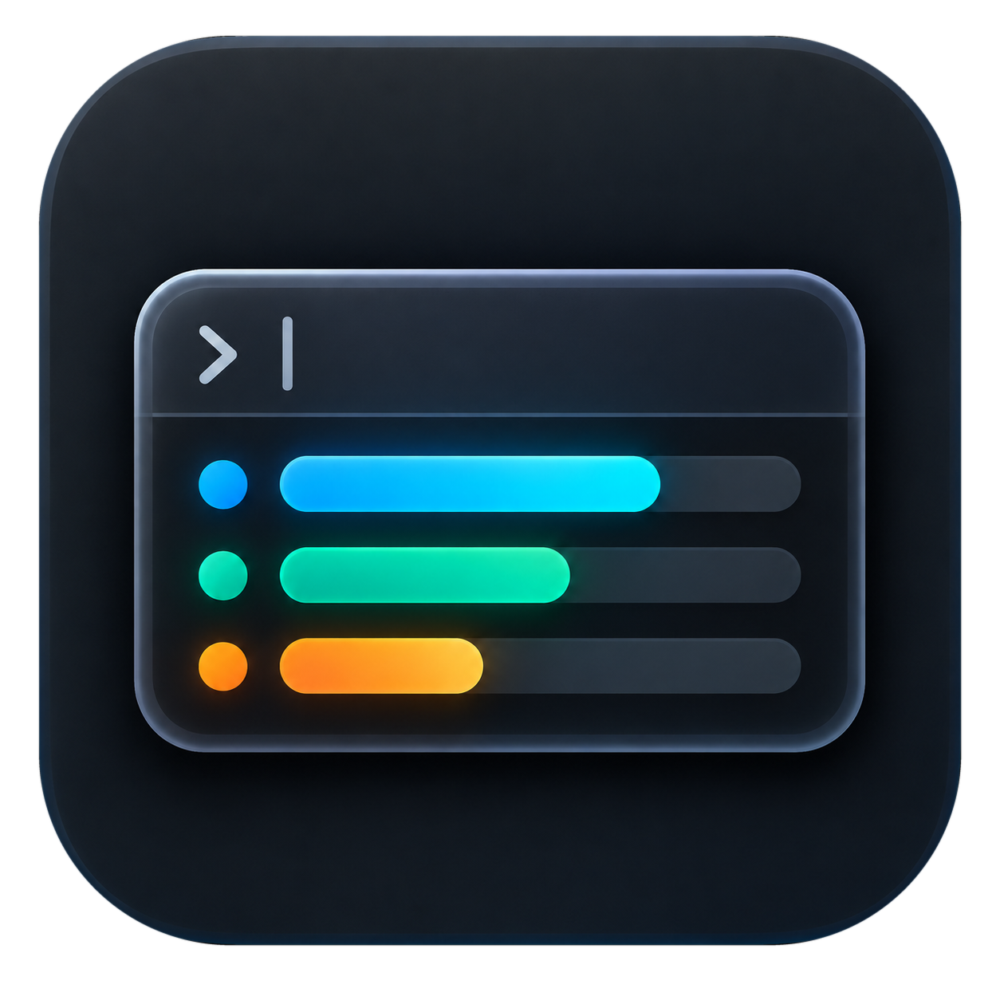
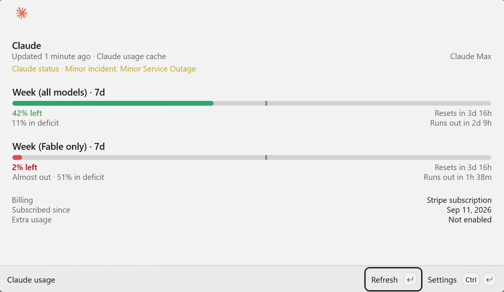
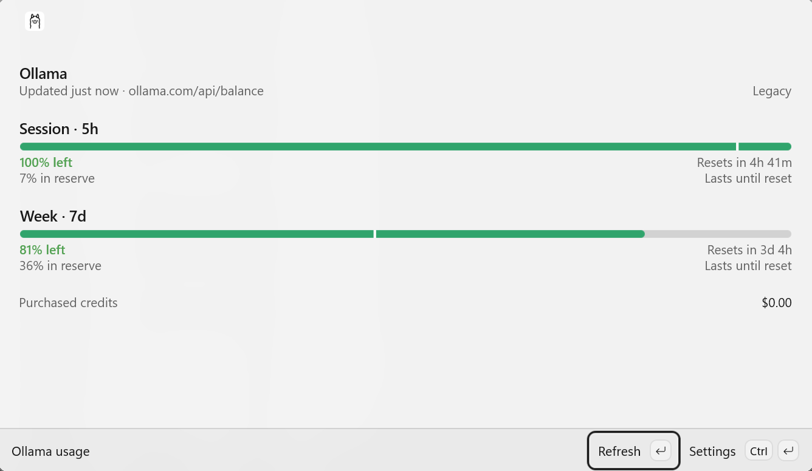
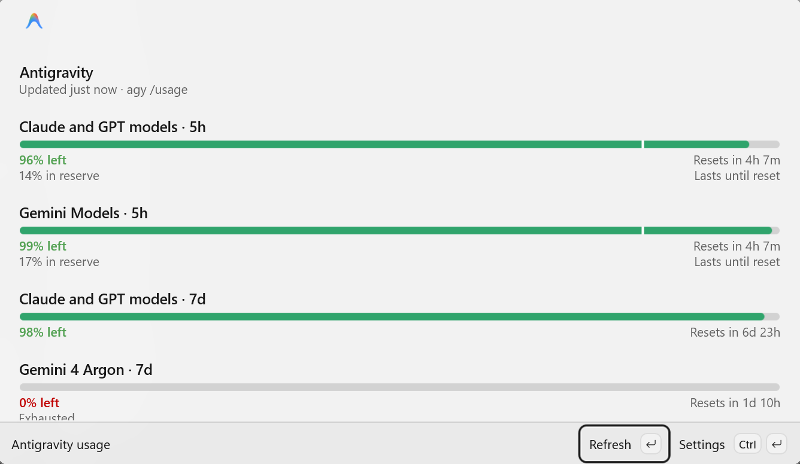

# AI Usage Dock

<p align="center">

</p>

A Windows PowerToys Command Palette extension that shows remaining Codex, Claude Code, Antigravity, and Ollama Cloud subscription capacity in the Command Palette Dock.

The extension delegates authentication and usage retrieval to the installed CLIs:

- Codex: starts the native `codex app-server --stdio` executable and calls `account/read` and `account/rateLimits/read`.
- Claude Code: reads the service-reported `cachedUsageUtilization` snapshot and the non-secret `oauthAccount` profile that Claude Code maintains in `~/.claude.json`. When the snapshot is stale, it asks `claude -p "/usage" --output-format json` for a refresh and rereads the cache.
- Antigravity: calls `agy -p "/usage" --mode plan --output-format json`, which returns quota data without consuming tokens, and reads the active account name from `~/.gemini/google_accounts.json`.
- Ollama Cloud: calls the documented `GET https://ollama.com/api/balance` endpoint with the API key entered in the extension settings (stored in Windows Credential Manager) or, failing that, the `OLLAMA_API_KEY` environment variable. Legacy Pro/Max plans report session and weekly windows; current plans report included credits for the billing period.

It never reads or stores OAuth access tokens. Ollama Cloud is the one provider whose usage is read directly, because it has no CLI usage command; its API key is kept in Windows Credential Manager, never in `settings.json`. The profile files it reads contain only account metadata; credentials live in separate files the extension does not open. With **Check provider status** on, it also reads the public status feeds of Claude and OpenAI, which carry no credentials.

See [QUIRKS.md](QUIRKS.md) for the non-obvious behaviour of the extension, Command Palette, and the CLIs, and [CHANGELOG.md](CHANGELOG.md) for what changed in each release.

## Screenshots

The bands sit on the Dock next to the built-in Performance Monitor. Selecting a band opens its detail page. The screenshots were taken with **Hide personal information** on.



| Ollama | Antigravity |
|---|---|
|  |  |

## Install a release

Requirements: Windows 11, PowerToys Command Palette 0.9 or newer with the Dock enabled, and a signed-in Codex, Claude Code, and/or Antigravity CLI, or an Ollama API key (create one at ollama.com/settings/keys and paste it into the **API key** field under **Ollama** in the extension settings).

Download the `.msix` and `.cer` from the [Releases](https://github.com/GChavez0210/AIUsageDock/releases) page, trust the certificate once, then install (elevated PowerShell):

```powershell
Import-Certificate -FilePath .\AIUsageDock.cer -CertStoreLocation Cert:\LocalMachine\TrustedPeople
Add-AppxPackage .\AIUsageDock.msix
```

Restart Command Palette, then add the bands you want under **Settings → Dock → Bands**: **Codex usage**, **Claude usage**, **Antigravity usage**, **Ollama usage**, and **AI usage overview** (every provider in one band). Enabling the extension in the Extensions list does not add bands by itself. Keep the AI bands after the built-in Performance Monitor band; [QUIRKS.md](QUIRKS.md#place-the-ai-bands-after-the-performance-monitor-band) explains why.

Use **Select subscriptions** in the extension, or its settings in Command Palette's installed extensions list, to turn off services you do not use. Disabled services are hidden from the extension's commands and Dock bands and are not refreshed.

## What you see

Each band shows remaining capacity for its service: `100%` is a full window and drains toward `0%`. Set **Show usage as** to **Percent used** to count the other way everywhere. The **AI usage overview** band names the tightest provider and lists the others; selecting it opens every enabled provider on one page. Selecting a provider band opens its detail page, laid out like the tray panel of [Win-CodexBar](https://github.com/nesszer/Win-CodexBar), with:

- A header with the provider name and account email, then how long ago usage was read and the plan.
- One section per limit window with a bar, the window length (`5h`, `7d`), the percentage, the reset as a countdown (or the clock time, under **Show reset times as**), and a pace line that compares usage with the time passed: "33% in reserve · Lasts until reset" or "5% in deficit · Runs out in 2d 20h". Bars are green, turn yellow at 75% used and red at 90% used or when the window is locked; **Warn at** and **Critical at** move those points. Set **Usage bar colors** to **Accent color** for one blue bar colour, as in Win-CodexBar.
- An **Account** block with what the CLI reports about the subscription:
  - Claude: plan, account, organization and role for team plans, billing type, subscription date, rate-limit tier when it is not the default, and extra-usage spend against the monthly cap. Per-model weekly caps appear as their own windows when the service reports them.
  - Codex: ChatGPT plan, account email, sign-in method, and credit balance.
  - Antigravity: active Google account, plus a plan or tier if a future CLI adds one to the quota payload.
  - Ollama Cloud: plan (`Legacy` for session/weekly plans), included credits left for the period on current plans, and purchased credit balance.
- A footer with the data source and when it was read.

While Claude or OpenAI has an open incident on its status page, the page says so and the band shows `incident` (**Check provider status**). A Windows notification is sent when a window reaches the warning or critical threshold or runs out (**Quota warnings**). **Hide personal information** leaves the account, organization and email addresses off the pages.

When a provider cannot be read, the page names the cause (CLI missing, not signed in, API key missing or rejected, timed out, no usage data) and says what to do about it.

## Build from source

Requirements: .NET 10 SDK (`10.0.401` or a later 10.0 feature band) and the Windows 11 SDK / WinUI development tools.

```powershell
./build.ps1
```

To build, test, register the staged package for the current user in development mode, and restart Command Palette:

```powershell
./build-and-install.ps1
```

The install script does not add a development certificate to a trust store.

## Continuous integration and releases

`.github/workflows/build.yml` builds and tests the extension on `windows-latest` for every push to `main` and every pull request, then packs a signed `AIUsageDock.msix` with `makeappx` and uploads it, together with the certificate's public half, as build artifacts.

Signing uses the `SIGNING_CERTIFICATE` repository secret, a base64 encoded PFX whose subject is `CN=AIUsageDock-Dev` so it matches the `Publisher` in `Package.appxmanifest`, with its password in `SIGNING_CERTIFICATE_PASSWORD`. Without those secrets the workflow generates a throwaway self-signed certificate, which still produces an installable package but means importing `AIUsageDock.cer` into **Local Machine → Trusted People** before Windows accepts it.

To release: bump `Version` in `Package.appxmanifest`, add the entry to [CHANGELOG.md](CHANGELOG.md), and push a matching `v*` tag, for example `v1.0.1`. The workflow stamps the version into the package identity and publishes a GitHub release carrying the `.msix` and the `.cer`.

To build the same signed package locally, run `./build-release.ps1`; it writes `AIUsageDock-<version>-<arch>.msix` (the OS architecture by default; pass `-Architecture x64` or `-Architecture arm64` to choose) and `AIUsageDock-Dev.cer` to `dist\`, creating a self-signed `CN=AIUsageDock-Dev` certificate in your user store the first time.

## Project layout

```text
AIUsageDock/
  Bands/          Dock presentation, one band per provider and the overview band
  Models/         Shared usage model and pace
  Notifications/  Quota warnings
  Pages/          Detail pages, the overview page and their wording
  Providers/      Claude, Codex, and Antigravity CLI adapters, Ollama Cloud HTTP adapter
  Status/         Provider status pages
AIUsageDock.Tests/
  Provider parser and process launch regression tests
```

See [THIRD_PARTY_NOTICES.md](THIRD_PARTY_NOTICES.md) for projects consulted while designing the extension.

## About

AIUsageDock by Gabriel Chavez - Developed in Mexico with love
